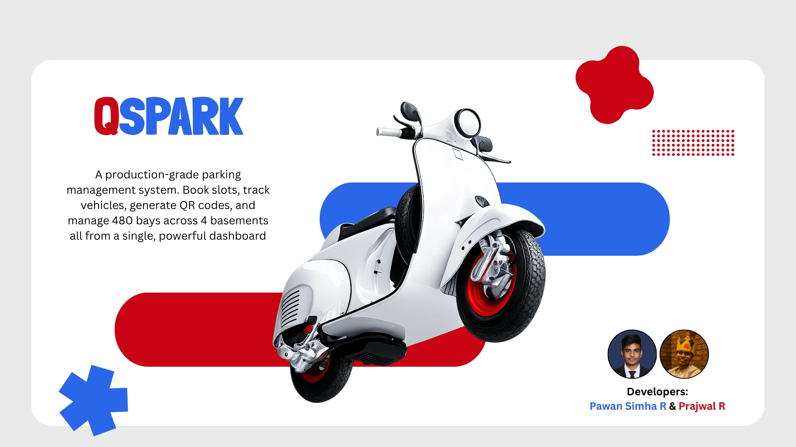

<div align="center">
  
  <h1 align="center">QSpark</h1>
  <p align="center"><i>Quick &amp; Smart Parking - Quick. Smart. Reliable.</i></p>

  <p align="center">
    
    
    
    
    
    
    
    
  </p>
</div>

---

<p align="center">
  
</p>

##  Product Strategy

**Problem:** Parking lots in commercial buildings rely on manual logbooks, suffer from double-booking conflicts, offer no real-time slot visibility, and lack historical tracking - wasting time, frustrating drivers, and creating administrative chaos.

**Solution:** QSpark is a production-grade parking management system that digitizes the entire workflow. It manages **480 parking slots** across **4 basements** with a server-rendered MVC dashboard, QR-based vehicle identification, session-based admin authentication (Spring Security + BCrypt), and full audit history. Every booking is tracked from entry to exit with timestamps.

---

##  Key Features

###  Admin Dashboard
| Feature | Detail |
|---------|--------|
| **Live Clock** | HH:MM:SS display with live date/time in the top bar |
| **Three-Tab Panel** | Booking (new entries with 4×120 slot grid), Occupied (active bookings), History (completed) |
| **Real-Time Slot Grid** | Clickable 15-column grid per basement - occupied slots disabled, quick-jump navigation |
| **Instant Search** | Client-side `filterTable()` matches across all columns in real time |
| **Column Sorting** | Click-to-sort with asc/desc indicators on any column |
| **CSV Export** | Download visible (filtered) rows from Occupied and History tables |
| **Pagination** | Client-side pagination with configurable rows-per-page |

###  Booking Management
| Feature | Detail |
|---------|--------|
| **Cascading Slot Selection** | Select basement → auto-generates 120 slot options |
| **Vehicle Number Validation** | Regex-enforced Indian formats: `KA 04 A 2256`, `DL 03 CA 1234`, `ML 04 ASD 5256`, `26 BH 9876 AB` |
| **Duplicate Detection** | Prevents double-booking a slot and duplicate active vehicle entries |
| **Mark as Left** | One-click exit time recording for completed parking |
| **Edit & Update** | Full CRUD with server-side validation and entry time preservation |

###  QR Code Integration
| Feature | Detail |
|---------|--------|
| **Generate QR** | Creates downloadable QR PNG via ZXing with vehicle details |
| **Scan QR** | Camera-based scanning via `html5-qrcode` - auto-fills dashboard booking form |
| **Vehicle Registration** | QR generation registers the vehicle; unregistered scans show error |
| **Registered Vehicles Table** | Lists all vehicles that have been issued QR codes |

###  Security & UX
| Feature | Detail |
|---------|--------|
| **Spring Security Auth** | BCrypt password hashing, form login/logout, CSRF protection on all forms |
| **Session Management** | Session invalidation on logout, secure headers (XSS, frame-deny, nosniff) |
| **Dark Mode** | Persisted preference via `localStorage`, toggle across all pages |
| **Responsive Design** | Breakpoints at 1024px, 768px, 480px |
| **Toast Notifications** | Auto-dismissing success/error/info toasts with optional undo |
| **Empty States** | Contextual empty-state UI for tables with no data |

---

##  Visual Architecture

```
Browser (HTML + CSS + JS)   ← Thymeleaf renders HTML
        ↓
Spring Boot (Controllers)   ← Spring Security auth guard
        ↓
JPA Repository Layer        ← Hibernate ORM
        ↓
Database (MySQL / H2)       ← 3 tables: admin, parking_slot, vehicle_registration
```

---

##  Tech Stack

| Layer | Technology | Purpose |
|-------|-----------|---------|
| **Backend** | Java 17, Spring Boot 3.3.1 | MVC framework, dependency injection |
| **Security** | Spring Security 6.0, BCrypt | Authentication, authorization, CSRF |
| **Database** | MySQL 8.0 (prod), H2 (dev) | Relational persistence |
| **ORM** | Spring Data JPA, Hibernate | Repository pattern, auto-DDL |
| **Frontend** | Thymeleaf 3.1, HTML5, CSS3 | Server-rendered templates |
| **UI Enhancements** | Vanilla JavaScript (625 lines) | Tab switching, toast, modal, sorting, search, CSV export, pagination, dark mode, vehicle format helpers, slot grid builder |
| **CSS** | Custom design system (1403 lines) | Design tokens, dark mode, responsive, animations |
| **QR Code** | ZXing 3.5.3 (core + javase) | QR generation and PNG output |
| **Scanner** | html5-qrcode (CDN) | Camera-based QR scanning |
| **Build** | Maven Wrapper (mvnw.cmd) | Build, test, run |
| **Validation** | Jakarta Validation (`@Pattern`) | Vehicle number format enforcement |

---

##  Project Structure

```
QSpark/
├── pom.xml                          # Maven config (Spring Boot 3.3.1)
├── mvnw.cmd / mvnw                  # Maven wrapper
├── QSpark.bat                       # Windows launcher
├── AGENTS.md                        # AI agent guide
├── README.md                        # This file
├── .gitignore / .gitattributes
├── data.sql / data-h2.sql           # Seed files (admin seed moved to DataInitializer)
│
├── src/main/java/com/qspark/
│   ├── QSparkApplication.java       # Entry point
│   ├── config/
│   │   ├── SecurityConfig.java      # Spring Security filter chain (71 lines)
│   │   ├── AdminDetailsService.java # UserDetailsService impl (31 lines)
│   │   └── DataInitializer.java     # Seeds admin with BCrypt password (29 lines)
│   ├── controller/
│   │   ├── LoginController.java     # GET /, /login (36 lines)
│   │   ├── ParkingController.java   # Dashboard + CRUD (245 lines)
│   │   └── QRCodeController.java    # QR generate/scan/list (121 lines)
│   ├── model/
│   │   ├── Admin.java               # Admin entity (60 lines)
│   │   ├── ParkingSlot.java         # Parking booking entity (124 lines)
│   │   └── VehicleRegistration.java # QR vehicle registry (69 lines)
│   └── repository/
│       ├── AdminRepository.java     # findByUsername (29 lines)
│       ├── ParkingRepository.java   # Slot + vehicle queries (34 lines)
│       └── VehicleRegistrationRepository.java  # findByVehicleNumber (28 lines)
│
├── src/main/resources/
│   ├── application.properties       # MySQL profile
│   ├── application-h2.properties    # H2 dev profile
│   ├── templates/                   # Thymeleaf views
│   │   ├── landing.html             # Marketing page (514 lines)
│   │   ├── login.html               # Auth page (309 lines)
│   │   ├── index.html               # Dashboard (490 lines)
│   │   ├── edit.html                # Edit booking (216 lines)
│   │   └── qrcode.html              # QR management (391 lines)
│   └── static/                      # Static assets
│       ├── css/styles.css           # Full design system (1403 lines)
│       ├── js/app.js                # Shared JS utilities (625 lines)
│       ├── logo.webp                # Brand logo
│       ├── hero-banner.webp         # Landing page hero image
│       └── favicon.ico              # Favicon
│
└── src/test/java/com/qspark/        # 63 tests
    ├── QSparkApplicationTests.java
    ├── controller/
    │   ├── LoginControllerTest.java       # 2 tests (public endpoints)
    │   ├── LoginIntegrationTest.java      # 4 tests (full-stack auth)
    │   ├── ParkingControllerTest.java     # 23 tests (CRUD + auth)
    │   └── QRCodeControllerTest.java      # 8 tests (QR + auth)
    ├── model/
    │   └── ParkingSlotValidationTest.java # 9 tests (regex patterns)
    └── repository/
        ├── AdminRepositoryTest.java       # 4 tests
        ├── ParkingRepositoryTest.java     # 6 tests
        └── VehicleRegistrationRepositoryTest.java  # 6 tests
```

---

##  Quick Start

### Prerequisites
- Java 17+
- MySQL 8.0+ (or use H2 for development without MySQL)

### 1. Clone & Navigate
```bash
git clone <repo-url>
cd QSpark
```

### 2. Run with H2 (No MySQL Needed)
```powershell
.\mvnw.cmd spring-boot:run "-Dspring-boot.run.profiles=h2"
```
The application starts at **http://localhost:8081**.

### 3. Run with MySQL
```powershell
# Set your MySQL password as environment variable
$env:DB_PASSWORD = "your_password"

# Ensure MySQL is running and database 'qspark' exists
.\mvnw.cmd spring-boot:run
```

### 4. Login
- **URL:** http://localhost:8081
- **Username:** `QSparker`
- **Password:** `QSpark@Secure`

### 5. Windows Quick Launcher
Double-click `QSpark.bat` - it checks port 8081, launches with H2 profile in a minimized window, opens the browser automatically.

---

##  API Endpoints

| Method | Path | Auth | Description |
|--------|------|------|-------------|
| `GET` | `/` | Public | Landing/marketing page |
| `GET` | `/login` | Public | Login form |
| `POST` | `/login` | Public | Login submission (Spring Security) |
| `POST` | `/logout` | Authenticated | Logout (POST with CSRF) |
| `GET` | `/dashboard` | Authenticated | Main dashboard with booking form, occupied, history |
| `POST` | `/save` | Authenticated | Create a new parking booking |
| `POST` | `/update` | Authenticated | Update an existing booking |
| `GET` | `/edit/{id}` | Authenticated | Edit form for a booking |
| `GET` | `/delete/{id}` | Authenticated | Delete a booking |
| `GET` | `/left/{id}` | Authenticated | Mark vehicle as exited |
| `GET` | `/qrcode` | Authenticated | QR code management page |
| `POST` | `/qrcode/generate` | Authenticated | Generate QR PNG (returns image) |
| `POST` | `/qrcode/scan` | Authenticated | Scan QR and redirect to dashboard |
| `GET` | `/qrcode/list` | Authenticated | List registered vehicles (JSON) |

---

##  Database Schema

### `admin`
| Column | Type | Constraints |
|--------|------|:-----------:|
| `id` | `INT` | PK, AUTO_INCREMENT |
| `username` | `VARCHAR` | UNIQUE |
| `password` | `VARCHAR(60)` | BCrypt hash |

### `parking_slot`
| Column | Type | Constraints |
|--------|------|:-----------:|
| `id` | `INT` | PK, AUTO_INCREMENT |
| `owner_name` | `VARCHAR` | |
| `vehicle_number` | `VARCHAR` | Validated by `@Pattern` regex |
| `vehicle_type` | `VARCHAR` | Car, Bike, Scooter, Auto Rickshaw, Electric Car, Electric Two Wheeler |
| `slot_number` | `VARCHAR` | Format: `B1-001` through `B4-120` |
| `mobile_number` | `VARCHAR` | 10 digits |
| `entry_time` | `DATETIME` | Set on booking |
| `exit_time` | `DATETIME` | `NULL` while active |

### `vehicle_registration`
| Column | Type | Constraints |
|--------|------|:-----------:|
| `id` | `BIGINT` | PK, AUTO_INCREMENT |
| `vehicle_number` | `VARCHAR` | UNIQUE, NOT NULL |
| `owner_name` | `VARCHAR` | |
| `vehicle_type` | `VARCHAR` | Same 6 types as parking_slot |
| `mobile_number` | `VARCHAR` | 10 digits |
| `created_at` | `DATETIME` | Set via constructor |

---

##  Product Roadmap

- **Rate Limiting** - Add login attempt throttling to `/login` to prevent brute-force attacks
- **PDF Receipts** - Generate printable parking receipts with QR code on exit
- **Multi-Admin Roles** - Role-based access (super admin, operator, viewer) with distinct permissions
- **REST API** - Expose CRUD operations via REST endpoints for third-party integrations
- **Real-Time Dashboard** - WebSocket-based slot grid updates without page reload

---

##  Developer Experience

### Running Tests
```powershell
# Run all 63 tests
.\mvnw.cmd test

# Run a specific test class
.\mvnw.cmd test -Dtest=ParkingControllerTest

# Run with H2 profile
.\mvnw.cmd spring-boot:run "-Dspring-boot.run.profiles=h2"
```

### CI/CD
- All tests pass before build (`mvn clean test`)
- Context loads successfully verified by `QSparkApplicationTests`
- Controller tests use `@WebMvcTest` with mocked repositories
- Integration tests use `@SpringBootTest` with H2 in-memory database

### Contributing
1. Fork the repository
2. Create a feature branch (`git checkout -b feature/amazing-feature`)
3. Commit your changes (`git commit -m 'Add amazing feature'`)
4. Push to the branch (`git push origin feature/amazing-feature`)
5. Open a Pull Request

---

##  License

Distributed under the GNU General Public License v3.0. See `LICENSE` for more information.
